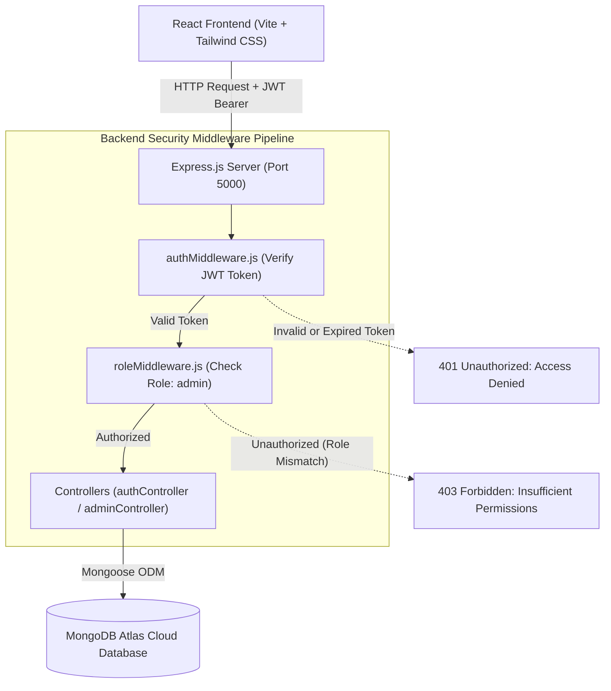

# AuthMatrix: Role-Based User Authentication & JWT Microservice

> **Mandatory Task 1:** Full Stack Role-Based Access Control (RBAC) & Secure JWT Authentication System  
> **Developed for:** Arrowstack Full Stack Web Development Internship (2026 Batch)  
> **Author:** Prerna Saini ([@prernas8107](https://github.com/prernas8107))  
> **Repository:** [https://github.com/prernas8107/Role-Based-User-Authentication-JWT-Microservice](https://github.com/prernas8107/Role-Based-User-Authentication-JWT-Microservice)

---


---

## 📖 Executive Summary

**AuthMatrix** is an enterprise-grade, production-ready Full Stack authentication microservice built using the **MERN (MongoDB, Express.js, React, Node.js)** architecture. 

It provides secure user registration, cryptographic password encryption, signed JWT authentication, and fine-grained **Role-Based Access Control (RBAC)** that strictly segregates **Standard Users** from **Administrators** across both the frontend client and backend API layers.

The frontend is crafted using **React 18** and **Tailwind CSS**, featuring an intuitive **Light Blue, Pastel Purple, and Crisp White** design system with frosted-glass navigation, real-time search & filters, live statistics, and role management controls.

---

## 🔑 Quick Demo Credentials (For Evaluator Testing)

The MongoDB Atlas cloud database is pre-seeded with active credentials for immediate evaluation of role boundaries:

| Account Role | Email | Password | Allowed Access & Responsibilities |
|---|---|---|---|
| 🛡️ **Administrator** | `admin@gmail.com` | `123456` | **Full Admin Panel Access**: Live statistics cards, real-time user search & filters, Make Admin / Remove Admin, Block / Unblock accounts, Add User modal, permanent deletion. |
| 👤 **Standard User** | `user@gmail.com` | `123456` | **User Profile Dashboard**: View profile data and assigned permissions. Access to `/admin` is strictly blocked with automatic redirection. |

> **💡 Evaluator Tip:** You can also register a fresh user through the `/register` portal (public registration defaults to the `user` role) to test self-registration, login redirection, and promoting that account to Admin using `admin@gmail.com`.

---

## ✨ Key Features & Capabilities

### 1. 🛡️ Authentication & Cryptography
* **Password Hashing**: Uses `bcryptjs` with 10 salt rounds to securely hash passwords before storing them in MongoDB. Plaintext passwords never touch the database.
* **Stateless JWT Tokens**: Upon successful login, the server issues a signed JSON Web Token containing the user's `id` and `role`.
* **Axios Request Interceptor**: Frontend automatically extracts the JWT from `localStorage` and attaches the `Authorization: Bearer <token>` header to all outgoing requests.
* **Account Status Protection**: Blocked users (`status: 'blocked'`) are rejected at the login gateway (`403 Forbidden`).

### 2. 👥 Role-Based Access Control (RBAC)
* **Standard User (`user`)**:
  * Clean personal dashboard displaying verified user details and access privileges.
  * Restricted from administrative endpoints and UI panels.
* **Administrator (`admin`)**:
  * **Dedicated Admin Control Panel** (`/admin`).
  * **4 Live Stats Cards**: Real-time counters for Total Users, Active Users, Blocked Users, and Admins.
  * **Search & Filters**: Instant debounced search by user name or email with dual dropdown filters for Role and Status.
  * **Role Toggle**: One-click **"Make Admin"** and **"Remove Admin"** actions.
  * **Account Moderation**: Instantly **Block** or **Unblock** users to suspend or restore their system access.
  * **Add New User Modal**: Create and configure new accounts directly into MongoDB.
  * **Account Deletion**: Safely delete user records.
  * **Self-Protection Guardrails**: Admins cannot accidentally demote or delete their own active session.

### 3. 🎨 UI & UX Design System
* **Curated Color Palette**: Crisp pure-white cards (`bg-white/95`), subtle ambient light blue and purple glowing mesh accents, and soft pastel status badges.
* **Contextual Navigation**: Active page indicator in the navbar (`Sign In` vs `Create Account`), persistent user badges, and smooth logout flows.
* **Fully Responsive**: Mobile, tablet, and desktop optimized layouts with Tailwind CSS.

---

## 🏛️ System Architecture



---

## 📂 Repository Structure

```text
Role-Based-User-Authentication-JWT-Microservice/
├── client/                               # Frontend Application
│   ├── public/
│   ├── src/
│   │   ├── components/
│   │   │   ├── Navbar.jsx               # Navigation bar with active page indicator
│   │   │   └── ProtectedRoute.jsx       # Route guard for authentication and roles
│   │   ├── context/
│   │   │   └── AuthContext.jsx          # Global authentication state and JWT storage
│   │   ├── pages/
│   │   │   ├── Login.jsx                # Login page with validation and role redirect
│   │   │   ├── Register.jsx             # Public registration (default role: user)
│   │   │   ├── Dashboard.jsx            # Standard user dashboard (profile & privileges)
│   │   │   └── AdminPanel.jsx           # Full admin management interface
│   │   ├── services/
│   │   │   └── api.js                   # Axios client with automated Bearer injection
│   │   ├── App.jsx                      # Client router and route definitions
│   │   ├── index.css                    # Tailwind CSS directives & theme styles
│   │   └── main.jsx                     # Vite React root
│   ├── index.html                       # HTML template with Google Font (Plus Jakarta Sans)
│   ├── package.json
│   ├── tailwind.config.js
│   └── vite.config.js
│
├── server/                               # Backend Microservice
│   ├── config/
│   │   └── db.js                        # MongoDB Atlas connection with DNS fallback
│   ├── controllers/
│   │   ├── authController.js            # Registration, login, and user profile logic
│   │   └── adminController.js           # Admin stats, search/filter, role & status updates
│   ├── middleware/
│   │   ├── authMiddleware.js            # JWT token verification
│   │   └── roleMiddleware.js            # Role-Based Access Control gatekeeper
│   ├── models/
│   │   └── User.js                      # User schema with roles (user, admin) & status
│   ├── routes/
│   │   ├── authRoutes.js                # Public and profile route endpoints
│   │   └── adminRoutes.js               # Protected admin route endpoints
│   ├── .env.example                     # Environment variables template
│   ├── package.json
│   └── server.js                        # Express server entry point
│
├── .gitignore                           # Excludes node_modules, .env, and build artifacts
└── README.md                            # Complete documentation & evaluator guide
```

---

## 📡 REST API Specification

### 1. Public Authentication Routes

| HTTP Method | Route | Description | Headers | Request Body |
|---|---|---|---|---|
| `POST` | `/api/auth/register` | Register a new user | `Content-Type: application/json` | `{ "name": "Alice", "email": "alice@example.com", "password": "password123" }` |
| `POST` | `/api/auth/login` | Authenticate user & get JWT | `Content-Type: application/json` | `{ "email": "alice@example.com", "password": "password123" }` |

### 2. Protected User Routes

| HTTP Method | Route | Description | Headers | Response |
|---|---|---|---|---|
| `GET` | `/api/auth/profile` | Fetch authenticated user data | `Authorization: Bearer <token>` | Returns user profile object without password |

### 3. Protected Admin Routes (Requires Role: `admin`)

| HTTP Method | Route | Description | Headers | Request / Query Params |
|---|---|---|---|---|
| `GET` | `/api/admin/stats` | Dashboard metrics | `Authorization: Bearer <token>` | None |
| `GET` | `/api/admin/users` | List & filter users | `Authorization: Bearer <token>` | Query params: `?search=john&role=user&status=active` |
| `POST` | `/api/admin/users` | Create user manually | `Authorization: Bearer <token>` | `{ "name": "Bob", "email": "bob@example.com", "password": "pass", "role": "admin" }` |
| `PATCH` | `/api/admin/users/:id` | Update status or role | `Authorization: Bearer <token>` | `{ "role": "admin" }` or `{ "status": "blocked" }` |
| `DELETE` | `/api/admin/users/:id` | Delete user permanently | `Authorization: Bearer <token>` | URL parameter: `:id` |

---

## 🚀 Local Installation & Setup Guide

### Prerequisites
* **Node.js** (v18.x or higher)
* **npm** (v9.x or higher)
* **MongoDB Atlas** cluster URI or local MongoDB daemon

---

### Step 1: Clone the Repository
```bash
git clone https://github.com/prernas8107/Role-Based-User-Authentication-JWT-Microservice.git
cd Role-Based-User-Authentication-JWT-Microservice
```

---

### Step 2: Backend Configuration & Startup
1. Navigate to the server folder:
   ```bash
   cd server
   npm install
   ```

2. Create a `.env` file in the `server` directory (reference `.env.example`):
   ```env
   PORT=5000
   MONGO_URI=your_mongodb_connection_string
   JWT_SECRET=your_jwt_secret_key_here
   ```

3. Start the backend development server:
   ```bash
   npm run dev
   ```
   *The backend will boot up on `http://localhost:5000` with connected MongoDB confirmation.*

---

### Step 3: Frontend Configuration & Startup
1. Open a new terminal and navigate to the client folder:
   ```bash
   cd client
   npm install
   ```

2. Start the Vite development server:
   ```bash
   npm run dev
   ```
   *The client interface will launch on `http://localhost:3000`.*

---

## 🧪 Testing the RBAC Workflows

1. **Verify Standard User Isolation**:
   - Log in using `user@gmail.com` / `123456`.
   - Observe the **User Profile Dashboard** with Standard User privileges.
   - Attempt to manually type `http://localhost:3000/admin` in the URL bar — the `ProtectedRoute` component will intercept the request and redirect back to `/login` or `/dashboard`.

2. **Verify Administrative Control**:
   - Log in using `admin@gmail.com` / `123456`.
   - Access the **Admin Control Panel** (`/admin`).
   - Test **"Make Admin"**: Click "Make Admin" on a user account to grant administrator rights.
   - Test **"Block"**: Click "Block" to suspend an account, log out, and attempt logging in with that account — observe the `403 Forbidden` block.
   - Test **"Unblock"**: Restore account access with a single click.

---

## 🛡️ Security Best Practices Implemented

* **Strict Input Validation**: Required parameters are checked before querying the database.
* **Cryptographic Salting**: Prevents rainbow table attacks using bcrypt with automatically generated salts.
* **Token Expiration**: JSON Web Tokens are configured with a validity period to prevent perpetual access.
* **CORS Protection**: Controlled origins enabled via Express `cors` middleware.
* **Environment Variable Safety**: Secrets (`MONGO_URI`, `JWT_SECRET`) are strictly excluded from version control via `.gitignore`.
* **SRV DNS Resilience**: Top-level Google DNS fallback (`8.8.8.8`, `8.8.4.4`) configured in Node.js to prevent Windows SRV lookup timeouts.

---

## 👩‍💻 Author & Internship Credits

* **Developer:** Prerna Saini  
* **GitHub Profile:** [@prernas8107](https://github.com/prernas8107)  
* **Internship Program:** Arrowstack Full Stack Web Development Internship (2026 Batch)  
* **Submission Module:** Mandatory Task 1 — Role-Based User Authentication & JWT Microservice  

---

<div align="center">
  <sub>Built with ❤️ using the MERN Stack & Tailwind CSS. Designed for the Arrowstack Full Stack Internship.</sub>
</div>
